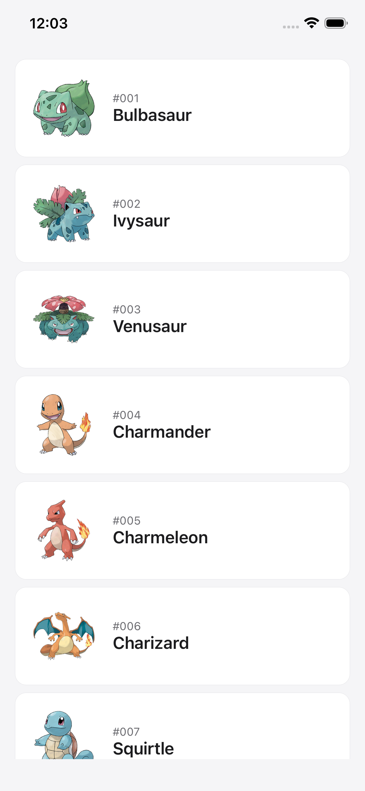
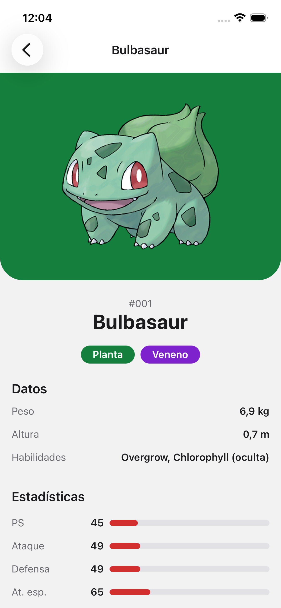

# Pokedex

App móvil hecha con React Native, Expo y TypeScript. Muestra la lista de Pokémon de [PokéAPI](https://pokeapi.co) y el detalle de cada uno: tipos, estadísticas, habilidades, peso y altura. Guarda los datos en el teléfono para poder verlos sin internet.

## Capturas

<p>
  
  
</p>

## Requisitos

- Node 24 (la versión está en `.nvmrc`: `nvm use`)
- CocoaPods 1.17.0 (`bundle install` lo instala desde el `Gemfile`)
- Xcode 26.4 o superior (para iOS) o Android Studio (para Android)

La app usa MMKV, que es código nativo, así que **no funciona en Expo Go**. Hay que compilarla como development build.

## Instalación

```bash
npm install
npx expo prebuild
npm run ios      # o: npm run android
```

## Comandos

| Comando             | Qué hace                      |
| ------------------- | ----------------------------- |
| `npm start`         | Inicia Metro                  |
| `npm test`          | Corre los tests               |
| `npm run typecheck` | Revisa los tipos              |
| `npm run lint`      | Revisa el código con ESLint   |
| `npm run check`     | Corre typecheck, lint y tests |
| `npm run format`    | Da formato con Prettier       |

## Arquitectura

El código está organizado por feature y cada feature tiene tres capas: `domain`, `application` e `infrastructure`, más `presentation` para la UI. Las dependencias apuntan hacia el dominio y la infraestructura se puede cambiar sin tocar el resto. Es arquitectura hexagonal (puertos y adaptadores), que es la misma idea de Clean Architecture.

```text
src/
  app/                      # providers, bootstrap y navegación
  features/
    pokemon/
      domain/               # modelos y enums
      application/          # puertos y casos de uso
      infrastructure/
        api/                # PokéAPI: dtos, mappers y repositorio
        cache/              # repositorio con cache y modo offline
      presentation/         # pantallas, hooks y componentes
  shared/                   # errores, http, storage y UI común
```

Reglas principales (ESLint las revisa):

- `domain` y `application` no importan React ni librerías de infraestructura.
- `presentation` no usa `fetch` ni el storage directamente. Usa los casos de uso desde `useDependencies()`.
- `app/composition-root.tsx` es el único lugar donde se crean los adaptadores.

### Cómo agregar un feature

1. Crear `src/features/<nombre>/` con las mismas carpetas y un `index.ts`.
2. Agregar una línea en `composition-root.tsx`.
3. Agregar sus rutas en `navigation/RootNavigation.tsx`.

## Librerías

| Librería                                             | Para qué                                           |
| ---------------------------------------------------- | -------------------------------------------------- |
| `react-native-mmkv`                                  | Guardar datos en el teléfono, con cifrado          |
| `expo-secure-store`                                  | Guardar la clave de cifrado en Keychain / Keystore |
| `expo-crypto`                                        | Generar la clave con números aleatorios seguros    |
| `@react-navigation/native` y `native-stack`          | Navegación entre pantallas                         |
| `jest`, `jest-expo`, `@testing-library/react-native` | Tests                                              |

No uso axios, Redux ni librerías de UI. Con `fetch` y hooks alcanza.

## Datos guardados y seguridad

- La cache usa MMKV con cifrado AES-256.
- La clave se crea una sola vez con `expo-crypto` y se guarda en Keychain (iOS) o Keystore (Android). No está en el código ni en archivos.
- El listado se guarda 24 horas y el detalle 7 días. Si no hay internet, se muestran los datos guardados aunque estén vencidos, con un aviso de "Sin conexión".
- Si la cache no se puede abrir, se borra y la app sigue. Si MMKV falla del todo, se usa memoria. La cache nunca bloquea la app.
- Las respuestas de PokéAPI se validan antes de usarse. Solo se usa HTTPS y las peticiones tienen un límite de 10 segundos.
- `android.allowBackup` está en `false`.

Los datos de PokéAPI son públicos. El cifrado es una medida extra, no un requisito.

No usé Firebase porque la app no necesita cuentas ni sincronización. Todo se guarda en el teléfono.

## Decisiones y mejoras

- La cache decide si el dato es fresco. Por eso el pull-to-refresh no vuelve a pedir datos mientras la cache esté vigente.
- Solo la lista tiene skeleton de carga. El detalle usa un indicador simple.
- Con más tiempo agregaría: CI en GitHub Actions, tests de las pantallas, columnas según el tamaño de pantalla, búsqueda, filtros por tipo y favoritos.
